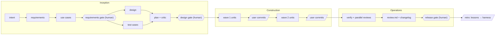

# AI-DLC — AI-Driven Development Lifecycle

How this repository builds software with AI agents. **AI plans and executes; humans decide at gates. The harness enforces it.**

*What* to build (vision, stack, structure, roadmap, specs) lives in [`docs/PROJECT_CONTEXT.md`](../PROJECT_CONTEXT.md); this guide covers *how*. Product decisions there override harness defaults. The phases map to work items, one at a time, and each phase closes at its `release` gate.

The previous harness described a good process in prose. Prose drifts: after context compaction, or under pressure to finish, a model skips steps. AI-DLC keeps the useful roles and artifacts, and moves every rule that matters into one of three places, each harder for the model to bend:

| Layer | Where | Strength |
|---|---|---|
| **Enforced** | hooks (`.claude/hooks/`) + permissions (`.claude/settings.json`) | the tool call is blocked or needs confirmation |
| **Validated** | `aidlc` CLI (`scripts/aidlc/`) + `npm run verify` | a gate can't be marked ready until artifacts are complete and traceable |
| **Guided** | rules, agents, commands (`.claude/`) | instructions, loaded only where relevant |

## Lifecycle



**Tracks (adaptive depth).** `feature` uses all three gates. `fix` and `chore` use a single `plan` gate (intent + root cause + plan), then `release`.

**Phase is derived, never stored.** It is computed from gate and unit state, so it cannot drift from reality.

## A work item

Every change is a work item: `docs/features/<slug>/` on branch `feat|fix|chore/<slug>`, based on `dev`.

| File | Written by | Gate |
|---|---|---|
| `intent.md` | orchestrator, with your answers | requirements / plan |
| `requirements.md` | `prd-writer` | requirements |
| `use-cases.md` | `ba-analyst` | requirements |
| `design.md` | `architect` | design |
| `test-cases.md` | `qa-planner` | design |
| `plan.md` | `planner`, then `plan-critic` | design / plan |
| `review.md` | `/merge-ready` | release |
| `journal.md` | everyone (append-only memory) | — |
| `state.json` | **only** the `aidlc` CLI | — |

Templates live in `docs/aidlc/templates/`. A file still containing `<!-- aidlc:template -->` counts as unfinished.

## Commands

| Command | Phase | Stops for you when |
|---|---|---|
| `/aidlc` | any | shows status and the single next step |
| `/inception <request>` | Inception | requirements ready; design ready |
| `/fix <bug>` | Inception (light) | plan ready |
| `/construction [U3 \| wave 2]` | Construction | after each wave, so you can review and commit |
| `/merge-ready` | Operations | release review ready |
| `/retro` | after release | proposes harness edits for your approval |

## Your part (the human)

```bash
npm run aidlc -- status                       # where are we?
npm run aidlc -- approve requirements         # after reading intent/requirements/use-cases
npm run aidlc -- reject design --note "split U3; cover expired sessions"
git add <files> && git commit -m "feat(api): …"   # you commit each unit/wave
```
Agents cannot run `approve` or `reject`; the hook blocks them. Approval records your git name and a hash of every artifact. If an approved file changes later, `status` and `verify` flag it until you approve it again.

## Guardrails (hooks)

| Hook | Guards against |
|---|---|
| `guard-bash` (PreToolUse Bash) | **deny:** `git commit` and `git push`, self-approval of gates, reading `.env`. **ask:** `reset --hard`, `clean -f`, `rm -rf`, `branch -D`, adding a dependency |
| `guard-files` (PreToolUse Read/Edit/Write) | **deny:** `.env` read/write, direct `state.json` edits, production code edits before the construction gate. **ask:** editing an approved artifact |
| `post-edit-check` (PostToolUse) | `node --check` on server JS and oxlint on client JS/JSX, right after every edit |
| `session-context` (SessionStart, incl. after compaction) | injects branch, work item, gates, units, next action and recent lessons |

Production code means `server/**` (except `.env.example`), `client/src/**`, `client/public/**`, `client/index.html` and `client/vite.config.*`. Docs, harness files and `docs/features/**` are always editable.

**Escape hatch for humans:** start Claude with `AIDLC_ENFORCE=off claude` to relax the phase gate and the confirmation prompts, for spikes or emergencies. The secrets, state-file, commit and self-approval rules stay on. The session context shows a warning while enforcement is off.

The guardrails are covered by tests in `scripts/aidlc/aidlc.test.mjs` (run by `npm run verify`). Any change to a hook or to `lib.mjs` comes with a test.

## Traceability

`aidlc ready design` refuses the gate unless:
- every use-case ID in `use-cases.md` (`UC-n`, `UC-n-A1`, `UC-n-E1`, `UC-n-EC1`) appears in `test-cases.md`
- every top-level `UC-n` is covered by a unit in `plan.md`
- no two units in the same wave touch the same file, so parallel agents can't collide

`/merge-ready` closes the loop: `qa-planner` audits each test case against a real test name.

## Agents

| Role | Agent | Model | Writes |
|---|---|---|---|
| Product Manager | `prd-writer` | sonnet | requirements.md, PRD index |
| Business Analyst | `ba-analyst` | sonnet | use-cases.md |
| Architect | `architect` | opus | design.md |
| QA Lead | `qa-planner` | sonnet | test-cases.md; traceability audit |
| Tech Lead | `planner` | opus | plan.md |
| Plan Critic | `plan-critic` | opus | findings only |
| Developer | `test-writer` | sonnet | failing tests (TDD red) |
| Security | `security-auditor` | opus | findings only |
| Reviewer | `code-reviewer` | sonnet | findings only |
| Integration | `verifier` | sonnet | findings only |
| QA Engineer | `e2e-runner` | sonnet | e2e tests |
| Tech Writer | `doc-updater` | sonnet | docs, CHANGELOG |
| CI | `build-runner` | haiku | runs `npm run verify` |
| Cleanup | `refactor-cleaner` | sonnet | behaviour-preserving edits |
| Data | `database-agent` | sonnet | Mongoose schemas, indexes, migrations |
| Performance | `performance-auditor` | sonnet | findings only |

Every agent ends its reply with an ```` ```aidlc-result ```` JSON block (verdict + counts). The orchestrator records it with `npm run aidlc -- record <check> <result>`.

## Learning loop

`/retro` reads a finished work item's history: rejections, retries, late findings. It writes specific lessons to `docs/aidlc/lessons.md` and drafts harness changes (a rule, an agent prompt, a guard plus its test). You approve what lands. The last five lessons are fed into every new session.

## Migration notes (2026-11-20)

- Removed `/bootstrap-feature`, `/develop-feature`, `/implement-slice` and `/context-refresh`. They are replaced by `/inception`, `/construction` and `/aidlc`, plus the SessionStart hook.
- `.claude/scratchpad.md` is replaced by each work item's `state.json` + `journal.md`. Several features can now be in flight at once.
- Feature docs moved from `docs/use-cases/` and `docs/qa/` into `docs/features/<slug>/`. `docs/PRD.md` §2 is now a feature index.
- Fixed contradictions: commit permission vs. the no-commit rule; references to a TypeScript typechecker, SQL and an ORM that don't exist here; "never ask the user" autonomy vs. human approval.
