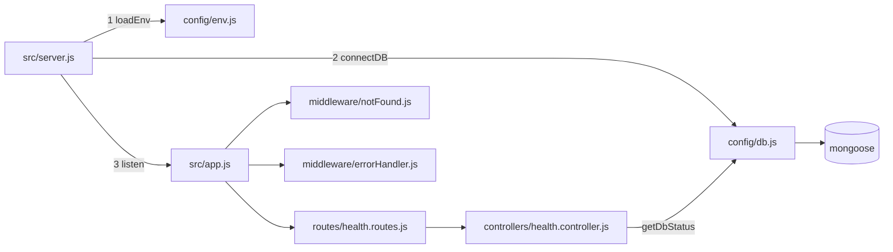

# Design: MongoDB Backend Connection

> Sources: [requirements](requirements.md), [use cases](use-cases.md), `docs/PROJECT_CONTEXT.md` §3 and §8, `.claude/rules/architecture.md`. Rewritten 2026-11-21 to use the decided `server/src/` layout and response envelope. The original review (PASS, five directives) is preserved in D1–D4.

## Verdict
**PASS.** A connection module, an env module and a thin app/server split satisfy UC-1…UC-3 and set up the Phase 1 folder structure that every later phase builds on.

## Component design

- `config/env.js` (new): the only place that reads `process.env`. Exports `getEnv()`, which reads at call time (not at require time) and returns `{ port, mongodbUri }`. `port` defaults to 5000; a missing or empty `MONGODB_URI` throws an error naming the variable and `server/.env.example` (D8).
- `config/db.js` (new): `connectDB(uri)` and `getDbStatus()`. Registers `connected` / `disconnected` / `error` listeners once (a module-level guard), so repeated calls never stack handlers. Logs show the redacted URI only.
- `app.js` (new): `cors()`, `express.json()`, mounts `/api/health`, then `notFound` and `errorHandler`. Never calls `listen()`.
- `server.js` (new): exports `start()` (`getEnv` → `connectDB` → `app.listen`; on failure logs the redacted error and calls `process.exit(1)`). The bottom of the file loads dotenv and calls `start()` only when `require.main === module` (D9).
- `utils/ApiError.js` (new): `new ApiError(status, message, errors?)`, mapped to the failure envelope by `errorHandler`.
- `server/index.js`: removed. `package.json` `main`/`start`/`dev` point to `src/server.js`.

## API contract
| Method | Path | Auth | Success | Errors |
|---|---|---|---|---|
| GET | /api/health | public | `200 { success: true, message: "Service healthy", data: { status: "ok", db: "connected" \| "disconnected" } }` | none of its own |
| any | unknown path | public | — | `404 { success: false, message: "Route not found: GET /x" }` |
| any | any (unhandled error) | — | — | `500 { success: false, message: "Something went wrong" }`; details logged server-side only |

## Data model
None: no collections, models or indexes in this work item.

## Decisions
### D1: Fail at startup, survive at runtime
- **Chosen:** a missing/invalid `MONGODB_URI` or a failed first connect → log + exit 1 before listening (UC-1-E1/E2/E3). A drop after startup → log and keep serving; health reports `disconnected` (UC-3).
- **Interview one-liner:** "A server that can't reach its database at boot is misconfigured, so it should fail loudly; a blip later is an outage the app should survive and report."

### D2: `db.js` never calls `process.exit`
- **Chosen:** `connectDB()` rejects with a descriptive error; only `server.js` decides to exit.
- **Interview one-liner:** "Modules report errors; only the entry point decides the process's fate, which keeps the module unit-testable."

### D3: Bounded server selection (`serverSelectionTimeoutMS: 5000`)
- **Interview one-liner:** "Without a timeout an unreachable DB hangs startup for ~30s; five seconds fails fast and visibly."

### D4: `readyState` mapping
- `1` → `"connected"`; `0`, `2`, `3` → `"disconnected"`.

### D5: `app.js` / `server.js` split
- **Chosen:** build the app in one file, start it in another.
- **Interview one-liner:** "Tests import the app and hit it with supertest without opening a port or connecting to a real database."

### D6: One response envelope + central error handler
- **Chosen:** `{ success, message, data }` / `{ success: false, message, errors? }`, produced by controllers and one `errorHandler`.
- **Interview one-liner:** "The frontend handles every response the same way, and error formatting lives in one place instead of in every route."

### D8: Env validation lives in `config/env.js`
- **Chosen:** env.js validates required variables, as architecture.md says. `connectDB(uri)` assumes it gets a valid string and reports only connection/driver failures.
- **Interview one-liner:** "Configuration errors are caught in one place before anything tries to use them."

### D9: Side-effect-free modules, `require.main` guard
- **Chosen:** `server.js` loads dotenv with `{ path: path.join(__dirname, '..', '.env'), quiet: true }` and calls `start()` only when run directly. Tests `require` it without touching the developer's `.env`, a real database or the real `process.exit`.
- **Interview one-liner:** "Requiring a module shouldn't start a server. The guard keeps the entry point testable, and the explicit path means `.env` is found whatever directory you start from."

### D10: Error handler honours 4xx from middleware
- **Chosen:** if an error carries `status`/`statusCode` 400–499 (e.g. body-parser's malformed JSON), use it and its message. Otherwise respond 500 with a generic message.

### D7: Jest + supertest
- **Options:** `node:test` (zero dependencies) vs Jest (the most widely used).
- **Chosen:** Jest, because interviewers recognise it and the skills transfer to the client's Vitest. **Confirm at this gate.**

## Risks & security notes
- Credential leakage: the URI can contain a password → never log it raw; log host/db only (U3, U4).
- Missing `.env` on a fresh clone → the error names `MONGODB_URI` and points at `server/.env.example` (U3).
- Moving `index.js` breaks the dev scripts → U4 updates `package.json` and verifies with `npm run dev:server` (U4).
